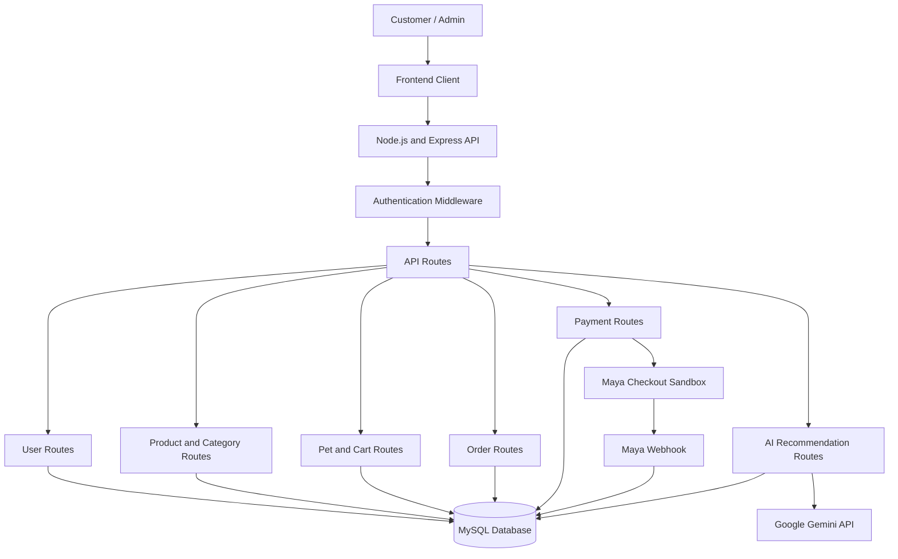
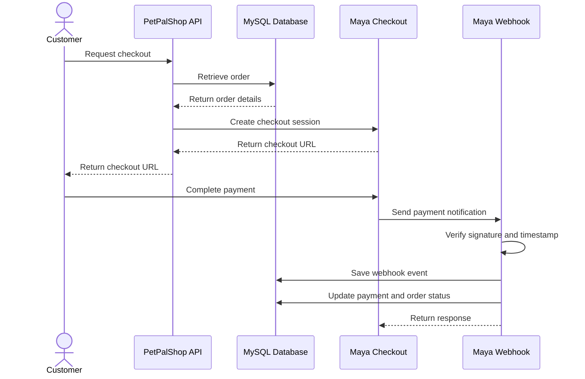
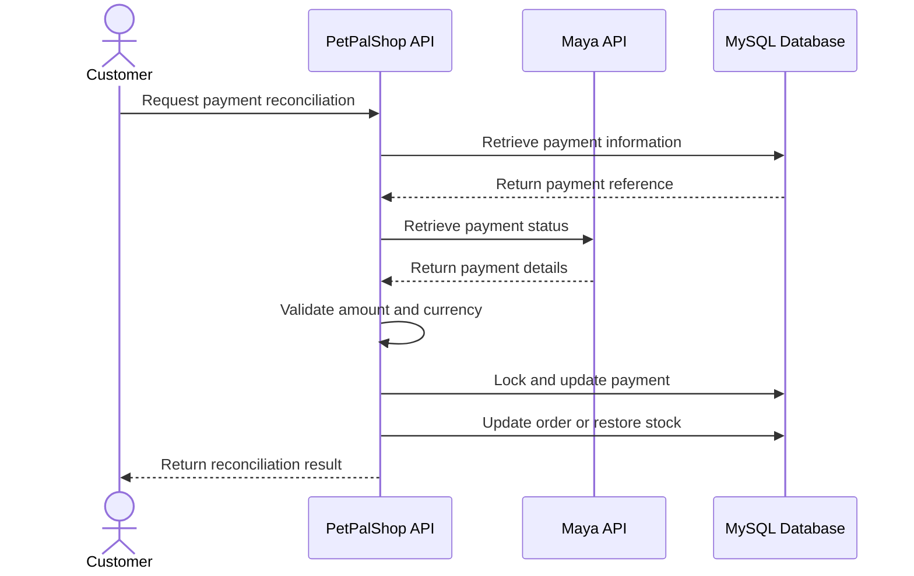

# PetPalShop System Architecture

## 1. System Overview
PetPalShop uses a client-server architecture. The backend is built with Node.js and Express.js, while MySQL stores the application's data. The backend handles authentication, products, categories, pets, shopping carts, orders, payments, and AI recommendations.

## 2. Architecture Diagram

## 3. Technology Stack
| Component | Technology |
|---|---|
| Backend | Node.js and Express.js |
| Database | MySQL |
| Authentication | JWT and bcryptjs |
| Payment Gateway | Maya Checkout Sandbox |
| AI Integration | Google Gemini API |
| API Documentation | Swagger UI and OpenAPI |
| Deployment | Render |
| Database Hosting | Railway |

## 4. Payment Checkout Sequence
The following diagram shows how a customer completes a payment using Maya Checkout.

## 5. Missed Webhook Reconciliation
If the Maya webhook notification is not received, the customer or authorized user can request payment reconciliation.

## 6. Security Measures
- Passwords are hashed using bcryptjs.
- JWT is used for authentication.
- Role-based middleware protects admin routes.
- SQL queries use parameterized statements.
- Helmet provides security headers.
- CORS controls cross-origin access.
- Rate limiting helps protect API endpoints.
- Maya webhook signatures and timestamps are verified.
- Environment variables protect sensitive credentials.