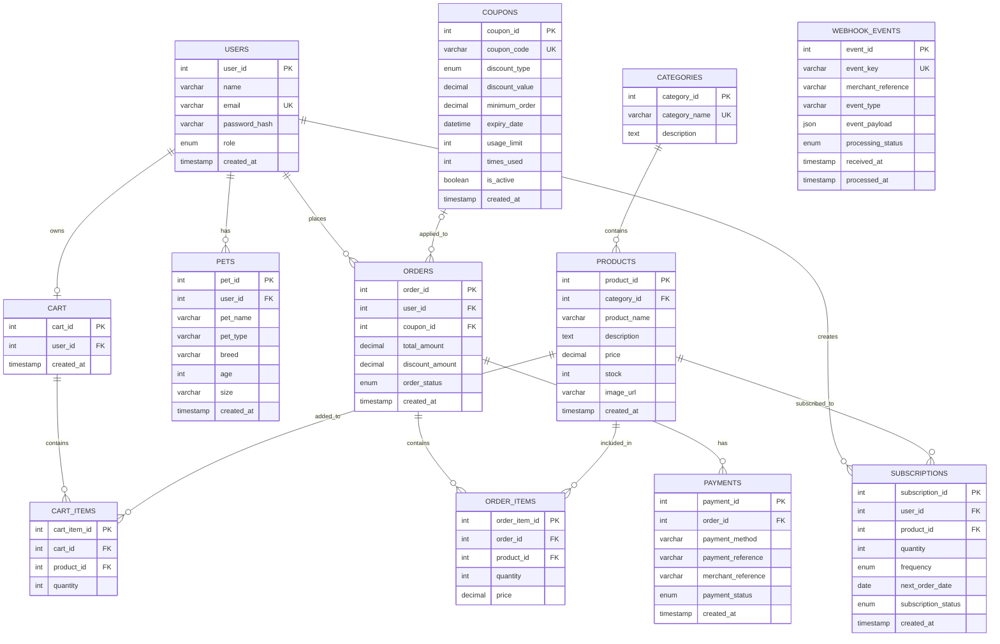

# PetPalShop Database Documentation

## Entity Relationship Diagram (ERD)
The following ERD shows the database tables, their primary keys, foreign keys, and relationships.

## Database Description
PetPalShop uses a MySQL relational database to store customer accounts, pet information, products, shopping carts, orders, payments, coupons, subscriptions, and webhook events. The database uses primary keys to identify records and foreign keys to connect related tables.

## Main Relationships
- One user can have multiple pets, orders, and subscriptions.
- One user can have at most one cart.
- One category can contain multiple products.
- One cart can contain multiple cart items.
- One product can appear in multiple cart items and order items.
- One order can contain multiple order items and payment records.
- One coupon can be applied to multiple orders.
- Webhook events are stored separately to track Maya payment notifications and prevent duplicate processing.